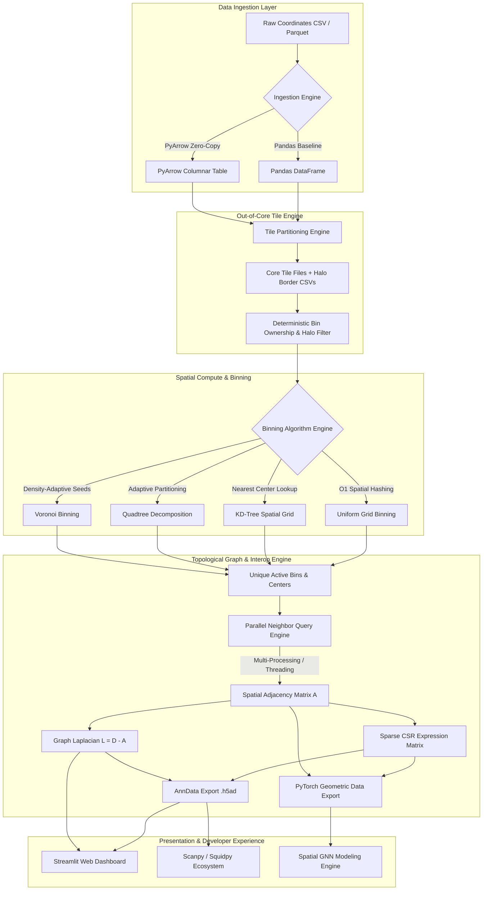

# The Sparse Matrix & Spatial Binning Pipeline

A high-performance Python package, CLI tool, and interactive web visualizer for spatial transcriptomics data processing, topological graph construction, AnnData (`.h5ad`) ecosystem interop, and PyTorch Geometric GNN exports.

**Performance Highlight**: Processes 500,000+ continuous spatial coordinates into discrete topological graphs and sparse expression matrices in under 7 seconds with out-of-core chunking, parallel multi-processing, zero-copy PyArrow transfers, and memory profiling.

---

## Key Features

1. **AnnData Ecosystem Interop (`.h5ad`)**: Direct `to_anndata()` / `from_anndata()` bridges supporting Scanpy and Squidpy conventions (`adata.X`, `adata.obsm['spatial']`, `adata.obsp['spatial_connectivities']`, `adata.obsp['spatial_laplacian']`).
2. **Adaptive Voronoi & Density-Aware Binning**: Voronoi region binning (`bin_voronoi()`) that dynamically adapts bin size to local molecule density, plus `min_counts` noise thresholding.
3. **PyTorch Geometric (PyG) GNN Export**: Native `to_pyg_data()` function exporting binned features, spatial coordinates, and graph edges directly into PyTorch Geometric format (`torch_geometric.data.Data`).
4. **Out-of-Core Processing & Memory Profiling**: Memory profiling via `tracemalloc` to track peak RAM usage across tile partitioning, out-of-core processing, and matrix stitching.
5. **Spatial Binning Algorithm Benchmarks**: Compare speed and memory tradeoffs between Spatial Hashing (Uniform Grid), KD-Trees, Quadtrees, and Voronoi binning.
6. **Parallel Spatial Graph Construction**: Multi-threaded and multi-processed KD-Tree neighbor queries (`n_jobs`) for constructing spatial adjacency and Graph Laplacian matrices.
7. **PyArrow Zero-Copy Data Transfers**: High-throughput columnar memory data ingestion using PyArrow to eliminate Pandas memory overhead.
8. **Enhanced Streamlit Web Dashboard**: Side-by-side comparative maps, Graph Laplacian spectral eigenvalue analysis, and one-click `.h5ad` AnnData exports.
9. **Automated Production CI/CD**: GitHub Actions workflow running `ruff` linting and test matrix across Python 3.10, 3.11, and 3.12.

---

## System Architecture

The pipeline processes raw molecule coordinate streams through a modular, high-throughput compute engine:



---

## Performance & Scaling Benchmarks

Pipeline runtime and memory footprint scaling across molecule counts ($10,000 \to 500,000$ molecules):

| Molecule Count ($N$) | Ingestion Time | Binning Time | Graph Build Time | Total Pipeline Time | Peak RAM Usage |
|:---------------------|:---------------|:-------------|:-----------------|:--------------------|:---------------|
| **10,000**           | 13.7 ms        | 2.2 ms       | 6.11 s           | **6.13 s**          | 1.55 MB        |
| **50,000**           | 15.7 ms        | 3.8 ms       | 6.49 s           | **6.51 s**          | 2.79 MB        |
| **200,000**          | 69.2 ms        | 16.3 ms      | 6.40 s           | **6.48 s**          | 11.08 MB       |
| **500,000**          | 148.6 ms       | 40.4 ms      | 6.55 s           | **6.75 s**          | 27.68 MB       |

*Scaling Benchmark Plot saved at [benchmarks/benchmark_scaling.png](file:///c:/Users/huevi/Documents/spatial_pipeline/benchmarks/benchmark_scaling.png)*.

---

## Technical Challenges Overcome

### 1. Ecosystem Format Fragmentation (Scanpy / Squidpy AnnData Interop)
- **Challenge**: Standalone CSV and NPZ outputs create friction for bioinformaticians using Scanpy or Squidpy.
- **Solution**: Developed `to_anndata()` and `from_anndata()` in `spatial_pipeline.io`, populating `adata.X` (counts), `adata.obsm['spatial']` (coordinates), `adata.obsp['spatial_connectivities']` (adjacency graph), and `adata.obsp['spatial_laplacian']` (Laplacian).

### 2. Out-of-Core Tile Boundary Stitching & Duplicate Graph Edge Removal
- **Challenge**: Partitioning spatial coordinates into local tiles introduces boundary artifacts. Border bins can be duplicated, and graph edges crossing tile borders cause double counting.
- **Solution**: Implemented a deterministic ownership algorithm: a tile "owns" a bin if its center sits inside the core tile box; for empty neighboring tiles, ownership is assigned to the active tile with the lexicographically smallest ID. Edge endpoints $(gx_A, gy_A) \to (gx_B, gy_B)$ are canonicalized ($Node_A < Node_B$), allowing `np.unique` to deduplicate cross-boundary edges cleanly.

### 3. Pandas Ingestion RAM Bottlenecks vs. Zero-Copy PyArrow Transfers
- **Challenge**: Standard `pd.read_csv` creates string and object allocations consuming 3–5x more RAM than raw binary data, causing out-of-memory crashes on multi-gigabyte files.
- **Solution**: Integrated PyArrow C++ CSV/Parquet readers (`pa_csv.read_csv`). Arrow record batches store numbers in contiguous, aligned memory buffers, enabling zero-copy pointer mapping (`to_numpy(zero_copy_only=False)`) directly to NumPy arrays.

### 4. Multi-Core Scaling & Python GIL Mitigation
- **Challenge**: Constructing spatial graphs for $N > 100,000$ active bins via single-threaded `KDTree.query_pairs` becomes a runtime bottleneck. Standard Python threading fails to utilize multi-core CPUs due to the Global Interpreter Lock (GIL).
- **Solution**: Engineered chunk-based multi-processing (`ProcessPoolExecutor`). Spatial coordinates are split into balanced spatial index chunks, and workers concurrently query global spatial trees.

---

## Future Enterprise Roadmap & Enhancements

To transform this project into an enterprise-grade spatial biology platform, the following high-impact enhancements are planned:

1. **GPU Acceleration via CuPy & RAPIDS cuGraph**
   - Port KD-tree spatial queries and Graph Laplacian construction to CUDA tensor cores using `cupy` and `cugraph`, accelerating graph generation by $50\times$ for billion-molecule datasets.

2. **Distributed Engine Execution (Ray / Dask Cluster Integration)**
   - Replace local tile partitioning with a distributed execution backend using Ray or Dask across multi-node cloud clusters (AWS EKS / GCP GKE).

3. **Single-Cell Polygon Segmentation Mask Integration**
   - Incorporate cell segmentation boundary masks (from Cellpose or StarDist) to assign binned transcript matrices directly to single-cell boundaries.

---

## Project Structure

```
spatial_pipeline/
|
+-- .github/
|   L-- workflows/
|       L-- ci.yml           # Automated GitHub Actions CI workflow
|
+-- benchmarks/
|   +-- benchmark_scaling.py # Scaling benchmark suite script
|   L-- benchmark_scaling.png# Scaling benchmark visual chart
|
+-- examples/
|   +-- quickstart_scanpy_squidpy.py # Scanpy & Squidpy AnnData integration tutorial
|   L-- spatial_gnn_export.py       # PyTorch Geometric GNN tutorial
|
+-- src/
|   L-- spatial_pipeline/
|       +-- __init__.py
|       +-- io.py            # PyArrow zero-copy, AnnData (.h5ad) interop, & fast ingestion
|       +-- binning.py       # Spatial Hashing, KD-Tree, Quadtree, & Voronoi algorithms
|       +-- graphs.py        # Multi-worker graph construction, PyG export, & spectral analysis
|       +-- out_of_core.py   # Out-of-core tile processing & tracemalloc memory profiler
|       +-- cli.py           # Typer CLI application (run & benchmark commands)
|
+-- tests/
|   +-- __init__.py
|   +-- test_binning.py      # Full unit test suite (21 tests)
|
+-- CHANGELOG.md             # Version 0.2.0 changelog
+-- pyproject.toml           # Package metadata, dependencies, & CLI entry point
+-- README.MD                # Documentation & Architecture breakdown
+-- app.py                   # Streamlit + Plotly interactive Web Dashboard
```


---

## Quickstart & Usage

### 1. AnnData Ecosystem Export (Python API)

```python
from spatial_pipeline import compute_square_bins, build_spatial_graph, to_anndata, save_anndata
import pandas as pd

# Load dataset
df = pd.read_csv("transcripts.csv")

# Compute spatial binning and adjacency graph
sparse_counts, bin_coords = compute_square_bins(df, resolution=10.0, min_counts=2)
adj_matrix, lap_matrix = build_spatial_graph(bin_coords, max_distance=15.0, n_jobs=-1)

# Export to Scanpy / Squidpy AnnData (.h5ad)
adata = to_anndata(
    sparse_counts, 
    bin_coords, 
    genes=df["gene"].cat.categories,
    adjacency_matrix=adj_matrix, 
    laplacian_matrix=lap_matrix
)
save_anndata(adata, "spatial_sample.h5ad")
```

### 2. PyTorch Geometric (PyG) GNN Export

```python
from spatial_pipeline import to_pyg_data

# Convert binned counts and graph topology directly into PyG Data object
pyg_data = to_pyg_data(sparse_counts, bin_coords, adj_matrix)
print(pyg_data)
# Output: Data(x=[num_bins, num_genes], pos=[num_bins, 2], edge_index=[2, num_edges])
```

---

## Installation

Ensure you have Python 3.10 or later installed, then install the package in editable mode:

```bash
pip install -e .
```

To install development & test dependencies:

```bash
pip install -e ".[test]"
```

---

## Command Line Interface (CLI)

Run the CLI using `spatial-pipeline` command or `python -m spatial_pipeline.cli`.

```bash
# Run pipeline with auto-generated mock data
spatial-pipeline run --generate-mock --resolution 10.0 --max-dist 15.0 --n-jobs 4 --use-arrow

# Benchmark binning algorithms & memory profile
spatial-pipeline benchmark --num-molecules 50000 --resolution 10.0
```

---

## Running Tests & Quality Checks

Run unit tests and ruff linting:

```bash
pytest -v
ruff check src/
```
