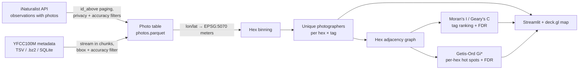

# Spatial Pipeline: Photo Hotspot Engine

[](https://github.com/gilbertorcp/spatial_pipeline/actions/workflows/ci.yml)
[](https://pypi.org/project/spatial-pipeline/)
[](https://opensource.org/licenses/MIT)

**Where should I go to photograph elk, bighorn sheep or columbines?** `spatial_pipeline` finds
wildlife and nature photo hotspots in millions of geotagged photos. It pulls photographed
observations from [iNaturalist](https://www.inaturalist.org) (free, no API key), bins them into
equal-area hexes, counts **unique photographers** rather than raw photos, and finds which species
cluster in space (Moran's I) and *where* their significant hot spots are (Getis-Ord Gi*).

On one month of real Denver-area observations (June 2025: 6,417 observations, 954 observers),
the significant hot spots land where a naturalist would point you. Black-tailed prairie dogs
cluster on the Rocky Mountain Arsenal refuge, mallards along the South Platte and city lakes, and
pinewoods geranium in the western foothills.

> **Status:** milestone 1 of [PLAN.md](PLAN.md): a hotspot map built from photo metadata.
> Image embeddings, seasonal and golden-hour timing, and the live "shoot tonight" layer come in
> later milestones.

---

## How it works



Design choices that matter for real photo data:

- **Photographer-weighted counts.** Each person counts once per tag per hex. Without this, one
  user who uploads 500 backyard shots creates a fake hotspot.
- **Equal-area projection.** Coordinates are projected to CONUS Albers (EPSG:5070) before
  binning, so every hex covers the same ground area and distances are in meters.
- **Share normalization.** Tags are ranked by their *fraction* of each hex's photographers,
  so a tag doesn't score high just because it appears where lots of people take photos.
- **Two questions, two statistics.** Moran's I answers *which* tags cluster in space at all.
  Local Getis-Ord Gi* answers *where*: it flags hexes whose neighborhood has significantly
  more of a tag than expected. P-values are FDR-corrected separately for each tag (thousands of
  hexes means thousands of tests). Comparisons are among photographed hexes only, so "hot"
  means hot relative to other places people shoot.
- **When, not just where.** For every tag, `hotspots` also writes month-of-year and hour-of-day
  profiles (`timing.parquet`), counted in unique photographers, with a *lift* against all photos.
  People are outdoors more in summer and at midday, so lift is what separates a real seasonal
  pattern (elk in the September rut) from that general bias. The tag ranking lists peak months,
  and the map shows both profiles for the selected tag.
- **No isolated hexes in the statistics.** Hexes without neighbors would inflate Moran's I under
  binary weights, so they are excluded (they still appear on the map).
- **No blurred locations.** iNaturalist randomizes the public coordinates of threatened species
  and of users who choose privacy. Those observations are excluded, along with any whose reported
  location uncertainty exceeds 1 km (configurable), because they would create false hot spots.
- **Streaming ingestion.** Metadata is read in chunks (SQLite pre-filters by bbox), so the full
  100M-row dataset can be cut down to a region without loading it into memory.

---

## Quickstart

### Install

```bash
git clone https://github.com/gilbertorcp/spatial_pipeline.git
cd spatial_pipeline
pip install -e .[test]
```

### Get the data

All sources produce the same photo table.

**iNaturalist (main source; free, no key).**

```bash
spatial-pipeline fetch-inat --bbox colorado --output photos.parquet
```

Each observation becomes one row. The observer counts as the photographer, and the tags are the
species' common name plus its group (`birds`, `mammals`, `plants`, ...). The defaults keep only
research-grade observations (identifications confirmed by the community) whose photos carry a
Creative Commons license, which is about **1.2 million** observations for Colorado. That
licensing also makes the photos usable for the image work in later milestones.

iNaturalist's normal paging stops at 10,000 results, so the fetcher pages by observation id,
which has no cap. It sends about one request per second as iNaturalist asks. A run stops after
9,000 requests (`--max-requests`) to stay under iNaturalist's guideline of ~10,000 per day. The
whole of Colorado takes several hours, because each request takes a few seconds. Every page is
cached in `.inat_cache/`, so rerunning the same command continues where it stopped. Use
`--observed-from` / `--observed-to` or `--bbox denver` for a quick first run.

**YFCC100M (historic Flickr photos up to 2014; landscapes and cities).** The YFCC100M metadata is published in the public AWS Multimedia Commons bucket as a single
SQLite database (`s3://multimedia-commons/tools/etc/yfcc100m_dataset.sql`, about **65.6 GB**).
The original Yahoo Webscope TSV (`yfcc100m_dataset`, optionally `.bz2`) also works. Both the
23-column and the 25-column layouts are detected automatically.

**Flickr API (requires a paid Flickr Pro account).** `fetch-flickr` is a tested, resumable
fetcher. It handles Flickr's ~4,000-result query cap by splitting date windows, then areas, and
reads the key from `FLICKR_API_KEY`. Flickr now issues API keys only to Pro members, so it is
kept for anyone who has one.

### Run

```bash
# 1. Get photos: iNaturalist (or ingest-yfcc for YFCC100M)
spatial-pipeline fetch-inat --bbox denver --observed-from 2025-06-01 --observed-to 2025-06-30 --output photos.parquet

# 2. Hex hotspots at 1 km, rank tags by spatial clustering
spatial-pipeline hotspots --input photos.parquet --output-dir hotspots --resolution 1000

# 3. Explore the map
spatial-pipeline ui
```

In the map, pick a subject in the sidebar, then click any hexagon to open that spot. The panel
shows its top subjects (★ = significant hot spot), photos with photographer credits, and a
directions link. The selection is kept in the URL (`?hex=...`), so a spot can be shared as a link.

`--bbox` accepts `colorado`, `denver`, or `min_lon,min_lat,max_lon,max_lat`.

### Python API

```python
from spatial_pipeline import DENVER_METRO_BBOX, INatClient, INatFetcher, compute_hotspots

fetcher = INatFetcher(INatClient(), cache_dir=".inat_cache")
photos = fetcher.fetch(INatFetcher.build_query(DENVER_METRO_BBOX, observed_from="2025-06-01"))
result = compute_hotspots(photos, resolution=1000.0)

result.ranking.head(20)   # tags ranked by Moran's I, with FDR-corrected p-values
result.local_hotspots     # significant Gi* hot spots per (hex, tag)
result.hexes              # hex centers (lon/lat), counts, photographer-density Gi*
result.label_counts       # photographers per (hex, tag)
```

---

## The engine underneath

The spatial core is not photo-specific. It works on any labeled 2D points:

| Module | What it does |
| :--- | :--- |
| `binning` | Square (spatial hashing), hexagonal (axial), KD-tree, quadtree and Voronoi binning; sparse bin × label matrices |
| `graphs` | Radius / k-NN spatial graphs (CPU multiprocessing or RAPIDS cuML on GPU), graph Laplacians, Moran's I, Geary's C, Getis-Ord Gi*, Benjamini-Hochberg FDR |
| `out_of_core` | Tiled processing with halo exchange for datasets larger than RAM, Dask binning |
| `io` | Parquet / CSV / PyArrow loaders, AnnData and Zarr export |
| `geo` | Bounding boxes, lon/lat ↔ projected coordinates |
| `photos` | YFCC100M readers, tag decoding and filtering |
| `inat` | Throttled, resumable iNaturalist fetcher (id-based paging, privacy and accuracy filters) |
| `flickr` | Throttled, resumable Flickr API fetcher that splits queries around the result cap (Pro key) |
| `hotspots` | Photographer-weighted hex hotspots and tag ranking |
| `timing` | Month and hour-of-day profiles per tag, with lift against all photos |

The generic `run`, `svg`, `export` and `benchmark` CLI commands still operate on any
`x, y, label` CSV.

---

## Testing

```bash
pytest
```

The photo tests use a synthetic fixture in the real YFCC layout (`tests/yfcc_fixture.py`),
clustered around real Colorado landmarks, with the edge cases the loader must handle: rows outside the
bbox, videos, missing geotags, low accuracy, duplicates, and a single prolific uploader.

> Performance numbers from earlier versions were measured on synthetic data and have been
> removed. New benchmarks on the real YFCC100M dataset are part of milestone 5.

---

## License

MIT. YFCC100M photos are Creative Commons licensed by their authors. This project
stores metadata only. Any thumbnails shown must credit the photographer and link to the original.
