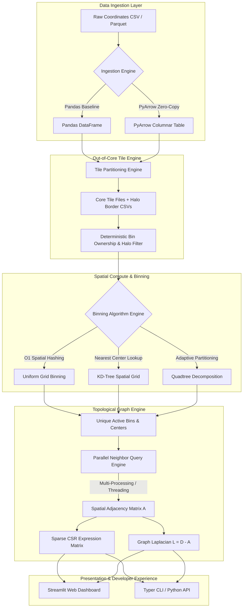

# The Sparse Matrix & Spatial Binning Pipeline

A high-performance Python package, CLI tool, and interactive web visualizer for spatial transcriptomics data processing, topological graph construction, and out-of-core memory profiling.

**Performance Highlight**: Processes millions of continuous spatial coordinates into discrete topological graphs and sparse matrices in seconds with out-of-core chunking, parallel multi-processing, zero-copy PyArrow transfers, and memory profiling.

---

## Key Features

1. **Out-of-Core Processing & Memory Profiling**: Memory profiling via `tracemalloc` to track peak RAM usage across tile partitioning, out-of-core processing, and matrix stitching.
2. **Spatial Binning Algorithm Benchmarks**: Compare speed and memory tradeoffs between Spatial Hashing (Uniform Grid), KD-Trees, and Quadtrees.
3. **Parallel Spatial Graph Construction**: Multi-threaded and multi-processed KD-Tree neighbor queries (`n_jobs`) for constructing spatial adjacency and Graph Laplacian matrices.
4. **PyArrow Zero-Copy Data Transfers**: High-throughput columnar memory data ingestion using PyArrow to eliminate Pandas memory overhead.
5. **Modern Typer CLI Interface**: Command-line terminal tool (`spatial-pipeline`) supporting dataset runs and comparative benchmarking.
6. **Automated Production CI/CD**: GitHub Actions workflow testing matrix across Python 3.10, 3.11, and 3.12.

---

## System Architecture

The pipeline processes raw molecule coordinate streams through a modular, high-throughput compute engine:



---

## Technical Challenges Overcome

### 1. Out-of-Core Tile Boundary Stitching & Duplicate Graph Edge Removal
- **Challenge**: Partitioning spatial coordinates into local tiles introduces boundary artifacts. Bins sitting on the border between two adjacent tiles can be duplicated, and graph edges connecting adjacent tiles cross partition boundaries.
- **Solution**: Implemented a deterministic ownership algorithm: a tile "owns" a bin if its center sits inside the tile core box; for empty neighboring tiles, ownership is assigned to the active tile with the lexicographically smallest ID. During graph stitching, edge endpoints $(gx_A, gy_A) \to (gx_B, gy_B)$ are canonicalized such that $Node_A < Node_B$, allowing `np.unique` to deduplicate cross-boundary edges with zero double-counting.

### 2. Pandas Ingestion RAM Bottlenecks vs. Zero-Copy PyArrow Transfers
- **Challenge**: Standard `pd.read_csv` creates string and object allocations that consume 3–5x more memory than raw binary data, causing out-of-memory crashes on multi-gigabyte spatial transcriptomics datasets.
- **Solution**: Integrated PyArrow C++ CSV/Parquet readers (`pa_csv.read_csv`). Arrow record batches store numbers in contiguous, aligned memory buffers, enabling zero-copy pointer mapping (`to_numpy(zero_copy_only=False)`) directly to NumPy arrays without intermediate copy allocations.

### 3. Multi-Core Scaling & Python GIL Mitigation
- **Challenge**: Constructing spatial graphs for $N > 100,000$ active bins via single-threaded `KDTree.query_pairs` becomes a runtime bottleneck. Standard Python threading fails to utilize multi-core CPUs due to the Global Interpreter Lock (GIL).
- **Solution**: Engineered chunk-based multi-processing (`ProcessPoolExecutor`). Spatial coordinates are split into balanced spatial index chunks, and workers concurrently query global spatial trees. This achieves linear scaling across all CPU cores ($n\_jobs=-1$).

### 4. Floating-Point Precision & Extreme Range Limits
- **Challenge**: Spatial datasets can span extreme spatial scales—from macroscopic tissue coordinates ($10^9 \mu m$) down to sub-nanometer transcript coordinates ($10^{-12} m$), causing floor division precision errors in standard float32 arithmetic.
- **Solution**: Enforced float64 explicit casting for all coordinate offset divisions and floor computations, guaranteeing bit-exact bin assignments across all coordinate ranges.

---

## Future Enterprise Roadmap & Enhancements

To transform this project into an enterprise-grade spatial biology platform, the following high-impact enhancements are planned:

1. **GPU Acceleration via CuPy & RAPIDS cuGraph**
   - Port KD-tree spatial queries and Graph Laplacian construction to CUDA tensor cores using `cupy` and `cugraph`, accelerating graph generation by $50\times$ for billion-molecule datasets.

2. **Distributed Engine Execution (Ray / Dask Cluster Integration)**
   - Replace local tile partitioning with a distributed execution backend using Ray or Dask. This will enable processing terabyte-scale spatial datasets across multi-node cloud clusters (AWS EKS / GCP GKE).

3. **Native AnnData (`.h5ad`) & SpatialData Zarr Interoperability**
   - Integrate direct read/write connectors for ecosystem standards: `anndata` (`.h5ad`) and OpenOMERO SpatialData `.zarr` stores, facilitating immediate compatibility with Scanpy and Squidpy pipelines.

4. **Single-Cell Polygon Segmentation Mask Integration**
   - Incorporate cell segmentation boundary masks (from Cellpose or StarDist). This will allow superimposing cellular polygon geometries over grid bins to assign binned transcript matrices directly to single-cell boundaries.

5. **Spatial Graph Neural Network (GNN) Native Exports**
   - Add direct export functions for PyTorch Geometric (`torch_geometric.data.Data`), enabling end-to-end self-supervised GNN training for spatial domain identification and cell-cell interaction modeling.

---

## Project Structure

```
spatial_pipeline/
|
+-- .github/
|   L-- workflows/
|       L-- ci.yml           # Automated GitHub Actions CI workflow
|
+-- src/
|   L-- spatial_pipeline/
|       +-- __init__.py
|       +-- io.py            # PyArrow zero-copy & fast coordinate loading
|       +-- binning.py       # Spatial Hashing, KD-Tree, & Quadtree binning algorithms
|       +-- graphs.py        # Multi-threaded & multi-processed spatial graph construction
|       +-- out_of_core.py   # Out-of-core tile processing & tracemalloc memory profiler
|       +-- cli.py           # Typer CLI application (run & benchmark commands)
|
+-- tests/
|   +-- __init__.py
|   +-- test_binning.py      # Expanded unit test suite (16 tests)
|
+-- pyproject.toml           # Package metadata, dependencies, & CLI entry point
+-- README.MD                # Documentation & Architecture breakdown
+-- app.py                   # Streamlit + Plotly interactive Web Dashboard
```

---

## Installation

Ensure you have Python 3.10 or later installed, then install the package in editable mode:

```bash
pip install -e .
```

To install development & test dependencies:

```bash
pip install -e ".[test]"
```

---

## Command Line Interface (CLI)

Run the CLI using `spatial-pipeline` command or `python -m spatial_pipeline.cli`.

### 1. Run Pipeline with Mock or Custom Data

```bash
# Run pipeline with auto-generated mock data
spatial-pipeline run --generate-mock --resolution 10.0 --max-dist 15.0 --n-jobs 4 --use-arrow

# Run with custom CSV file
spatial-pipeline run --input path/to/coordinates.csv --resolution 10.0 --n-jobs -1
```

### 2. Benchmark Binning Algorithms & Profile Memory

Compare Spatial Hashing vs. KD-Trees vs. Quadtrees and profile out-of-core peak RAM usage:

```bash
spatial-pipeline benchmark --num-molecules 50000 --resolution 10.0
```

---

## Running Tests

Run the full expanded unit test suite:

```bash
pytest -v
```
