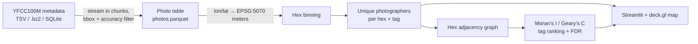

# Spatial Pipeline: Photo Hotspot Engine

[](https://github.com/gilbertorcp/spatial_pipeline/actions/workflows/ci.yml)
[](https://pypi.org/project/spatial-pipeline/)
[](https://opensource.org/licenses/MIT)

**Where and when should I shoot?** `spatial_pipeline` finds photo hotspots from millions of
geotagged photos. It streams [YFCC100M](https://multimediacommons.wordpress.com/yfcc100m-core-dataset/)
Flickr metadata, bins photos into equal-area hexes, counts **unique photographers** (not raw
photos), and ranks tags by how strongly they cluster in space (Moran's I). That separates
place-specific subjects like `maroon bells` or `red rocks` from tags that show up everywhere,
like `colorado`.

> **Status:** milestone 1 of [PLAN.md](PLAN.md): a Colorado hotspot map built from metadata only.
> Image embeddings, hidden-gem scoring, golden-hour timing and the live "shoot tonight" layer
> come in later milestones.

---

## How it works



Design choices that matter for real photo data:

- **Photographer-weighted counts.** Each person counts once per tag per hex. Without this, one
  user who uploads 500 backyard shots creates a fake hotspot.
- **Equal-area projection.** Coordinates are projected to CONUS Albers (EPSG:5070) before
  binning, so every hex covers the same ground area and distances are in meters.
- **Share normalization.** Tags are ranked by their *fraction* of each hex's photographers,
  so a tag doesn't score high just because it appears where lots of people take photos.
- **No isolated hexes in the statistics.** Hexes without neighbors would inflate Moran's I under
  binary weights, so they are excluded (they still appear on the map).
- **Streaming ingestion.** Metadata is read in chunks (SQLite pre-filters by bbox), so the full
  100M-row dataset can be cut down to a region without loading it into memory.

---

## Quickstart

### Install

```bash
git clone https://github.com/gilbertorcp/spatial_pipeline.git
cd spatial_pipeline
pip install -e .[test]
```

### Get the data

The YFCC100M metadata is published in the public AWS Multimedia Commons bucket as a single
SQLite database (`s3://multimedia-commons/tools/etc/yfcc100m_dataset.sql`, about **65.6 GB**).
The original Yahoo Webscope TSV (`yfcc100m_dataset`, optionally `.bz2`) also works. Both the
23-column and the 25-column layouts are detected automatically.

### Run

```bash
# 1. Keep geotagged Colorado photos (street-level accuracy by default)
spatial-pipeline ingest-yfcc --input yfcc100m_dataset.sql --output photos.parquet --bbox colorado

# 2. Hex hotspots at 1 km, rank tags by spatial clustering
spatial-pipeline hotspots --input photos.parquet --output-dir hotspots --resolution 1000

# 3. Explore the map
spatial-pipeline ui
```

`--bbox` accepts `colorado`, `denver`, or `min_lon,min_lat,max_lon,max_lat`.

### Python API

```python
from spatial_pipeline import COLORADO_BBOX, compute_hotspots, read_yfcc_metadata

photos = read_yfcc_metadata("yfcc100m_dataset.sql", bbox=COLORADO_BBOX)
result = compute_hotspots(photos, resolution=1000.0)

result.ranking.head(20)   # tags ranked by Moran's I, with FDR-corrected p-values
result.hexes              # hex centers (lon/lat), photo and photographer counts
result.label_counts       # photographers per (hex, tag)
```

---

## The engine underneath

The spatial core is not photo-specific. It works on any labeled 2D points:

| Module | What it does |
| :--- | :--- |
| `binning` | Square (spatial hashing), hexagonal (axial), KD-tree, quadtree and Voronoi binning; sparse bin × label matrices |
| `graphs` | Radius / k-NN spatial graphs (CPU multiprocessing or RAPIDS cuML on GPU), graph Laplacians, Moran's I, Geary's C |
| `out_of_core` | Tiled processing with halo exchange for datasets larger than RAM, Dask binning |
| `io` | Parquet / CSV / PyArrow loaders, AnnData and Zarr export |
| `geo` | Bounding boxes, lon/lat ↔ projected coordinates |
| `photos` | YFCC100M readers, tag decoding and filtering |
| `hotspots` | Photographer-weighted hex hotspots and tag ranking |

The generic `run`, `svg`, `export` and `benchmark` CLI commands still operate on any
`x, y, label` CSV.

---

## Testing

```bash
pytest
```

The photo tests use a synthetic fixture in the real YFCC layout (`tests/yfcc_fixture.py`),
clustered around real Colorado landmarks, with the edge cases the loader must handle: rows outside the
bbox, videos, missing geotags, low accuracy, duplicates, and a single prolific uploader.

> Performance numbers from earlier versions were measured on synthetic data and have been
> removed. New benchmarks on the real YFCC100M dataset are part of milestone 5.

---

## License

MIT. YFCC100M photos are Creative Commons licensed by their authors. This project
stores metadata only. Any thumbnails shown must credit the photographer and link to the original.
