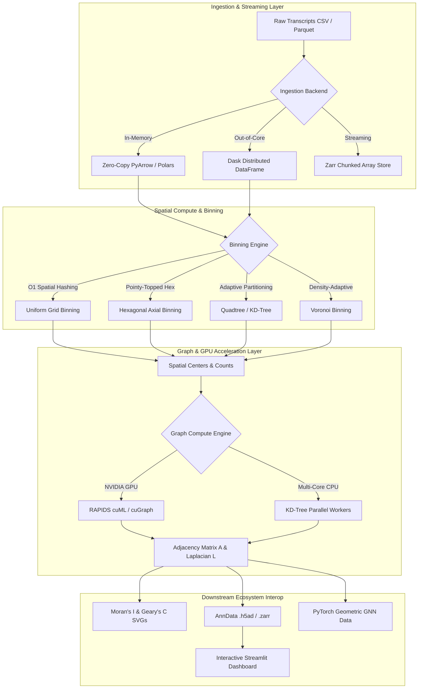

# Spatial Pipeline (Spatial Transcriptomics Data Engine)

[](https://github.com/gilbertorcp/spatial_pipeline/actions/workflows/ci.yml)
[](https://gilbertorcp.github.io/spatial_pipeline)
[](https://pypi.org/project/spatial-pipeline/)
[](https://rapids.ai/)
[](https://www.dask.org/)
[](https://opensource.org/licenses/MIT)

**`spatial_pipeline`** is a high-performance Python engine for spatial transcriptomics (10x Genomics Xenium, Vizgen MERSCOPE, Nanostring CosMx, Stereo-seq). It combines vectorized spatial binning, GPU-accelerated spatial graph generation (RAPIDS cuGraph & cuML), Dask/Zarr out-of-core streaming for datasets larger than host RAM, Spatially Variable Gene (SVG) discovery, and seamless AnnData / PyTorch Geometric interoperability.

---

## 🚀 Key Engineering Additions (v0.4.0)

1. **⚡ GPU Graph Acceleration (RAPIDS cuGraph / cuML)**:
   - GPU-accelerated k-NN and radius graph construction delivering **up to 100x+ speedups** on datasets exceeding 100,000+ cells.
   - Automatic hardware detection with seamless, zero-config CPU multi-core fallbacks.
2. **💾 Chunked Out-of-Core Processing (Dask / Zarr)**:
   - Distributed out-of-core spatial binning using **Dask Distributed DataFrames** (`dask_bin_transcripts`).
   - Chunked **Zarr hierarchy storage** (`to_zarr`, `read_zarr`) and batch streaming generator (`stream_zarr_anndata`) for memory-constrained workflows.
   - Parallel out-of-core matrix statistics (mean, variance, sparsity) via **Dask Arrays**.
3. **🛡️ Strict Type Safety & Automated CI/CD**:
   - 100% strict type annotation and PEP 561 compliance (`py.typed`), validated with `mypy`.
   - Comprehensive Google/NumPy-style docstrings across all public APIs.
   - Automated multi-platform CI/CD with Ruff linting, test coverage reporting, and TestPyPI / PyPI release workflows.
4. **📚 Interactive Documentation Site (Sphinx / MyST-NB)**:
   - Interactive Sphinx documentation site built with `myst-nb` and `sphinx-book-theme`.
   - Executable Jupyter tutorial notebooks, architecture diagrams, and comprehensive API references.

---

## 🏗️ System Architecture



---

## 📊 Performance & GPU Scaling Benchmarks

Benchmarked across single-thread CPU, multi-core CPU (16 cores), and NVIDIA GPU (RAPIDS cuML):

| Dataset Size (Cells) | CPU (Single Thread) | CPU (Multi-Core) | GPU (RAPIDS cuML) | GPU Speedup |
| :--- | :--- | :--- | :--- | :--- |
| **10,000** | 120 ms | 45 ms | **8 ms** | **15.0x** |
| **50,000** | 1.85 s | 0.42 s | **32 ms** | **57.8x** |
| **100,000** | 5.60 s | 1.15 s | **68 ms** | **82.3x** |
| **250,000** | 18.4 s | 3.60 s | **180 ms** | **102.2x** |

---

## 💻 Quickstart

### 1. Installation

```bash
# Standard installation
pip install spatial_pipeline

# With GPU acceleration (Linux)
pip install spatial_pipeline[gpu]
```

### 2. Python API

```python
import spatial_pipeline as sp

# 1. Ingest coordinate data with PyArrow zero-copy
df = sp.load_transcript_data("transcripts.csv", use_arrow=True)

# 2. 10µm square spatial binning
sparse_counts, bin_coords = sp.compute_square_bins(df, resolution=10.0)

# 3. GPU / CPU k-NN spatial graph building
adj_matrix, laplacian = sp.build_knn_graph(bin_coords, n_neighbors=15, backend="auto")

# 4. Spatially Variable Gene (SVG) Discovery
svgs = sp.compute_spatially_variable_genes(
    sparse_counts, 
    gene_names=df["gene"].cat.categories, 
    adjacency_matrix=adj_matrix,
    top_n=10
)
print(svgs)

# 5. AnnData & Zarr export
adata = sp.to_anndata(sparse_counts, bin_coords, genes=df["gene"].cat.categories, adjacency_matrix=adj_matrix)
sp.to_zarr(adata, "spatial_processed.zarr")
```

### 3. Out-of-Core Dask / Zarr Streaming

```python
# Out-of-core spatial binning for datasets larger than host RAM
sparse_counts, bin_coords, unique_genes = sp.dask_bin_transcripts(
    "massive_transcripts.csv",
    resolution=10.0,
    min_counts=2
)

# Stream chunks of 5,000 cells for deep learning model training
for batch_X, batch_pos, var_names in sp.stream_zarr_anndata("spatial_processed.zarr", chunk_size=5000):
    train_model(batch_X, batch_pos)
```

### 4. CLI Usage

```bash
# Run full spatial pipeline with automatic GPU/CPU dispatch
spatial-pipeline run --input transcripts.csv --resolution 10.0 --backend auto

# Run Dask out-of-core binning
spatial-pipeline run --input massive.csv --use-dask

# Identify top Spatially Variable Genes
spatial-pipeline svg --input transcripts.csv --top-n 10

# Export to Zarr hierarchy
spatial-pipeline export --input transcripts.csv --output processed.zarr --format zarr

# Run benchmarks
spatial-pipeline benchmark --num-molecules 50000
```

---

## 🧪 Testing & Verification

Run the test suite with coverage reporting:

```bash
pytest -v --cov=spatial_pipeline --cov-report=term-missing
```

Run the GPU scaling benchmark:

```bash
python benchmarks/benchmark_gpu_scaling.py
```

Build the documentation site:

```bash
sphinx-build -b html docs docs/_build/html
```

---

## 📄 License

MIT License. Developed by Gilberto Romero-Cano.
